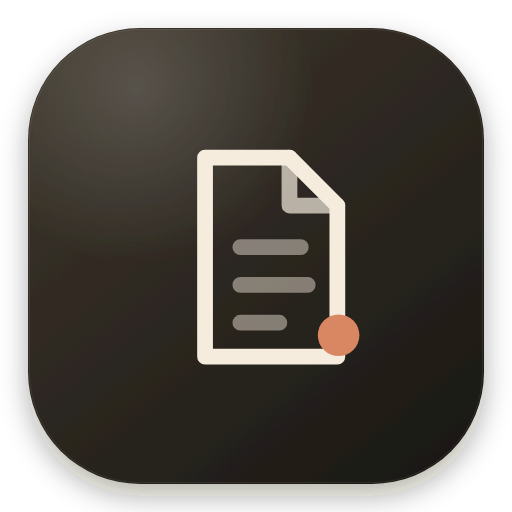
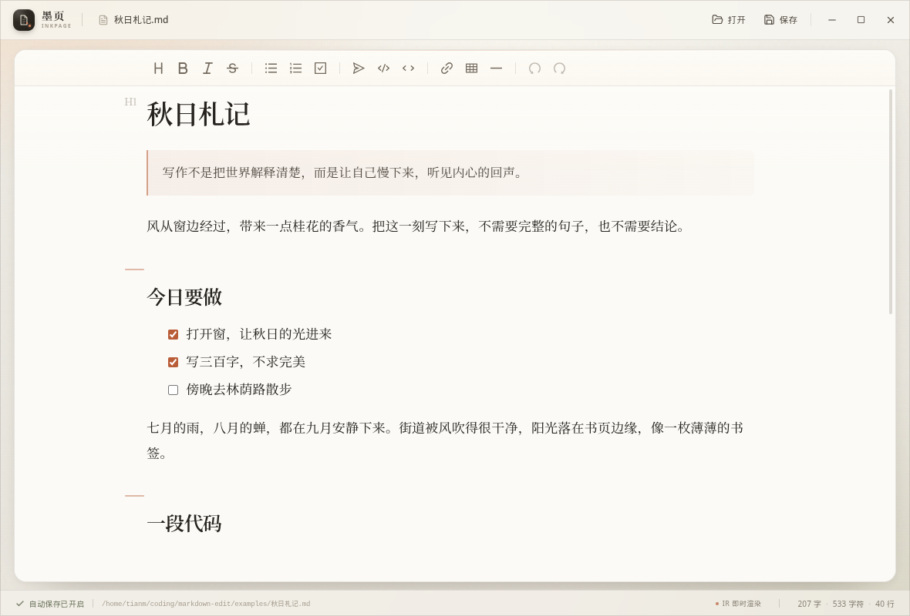

# 墨页 · Inkpage

<p align="center">
  <br />
  <strong>一款为专注书写而生的桌面 Markdown 编辑器。</strong><br />
  Electron + React + Vditor IR · 单屏即时渲染 · 自动保存 · 完全本地
</p>


## 关于

墨页把一次写作收敛为一件事情：**打开一个 Markdown 文件，然后安静地写**。
界面采用暖白纸张、墨色文字与陶土色点缀，编辑器使用 Vditor 的 **IR 即时渲染** 模式，
在一个屏幕里完成 Markdown 的输入与最终预览。文件自动保存到本地，不需要云服务，
也不需要离开当前窗口。

版本：`0.1.0` · 状态：可运行 MVP



## 功能

- **单屏 IR 编辑**：Vditor `ir` 模式，Markdown 源码与渲染结果处于同一视图。
- **打开 / 编辑 / 保存单个 Markdown 文件**：原生文件选择器，UTF-8 读取，支持
  `.md`、`.markdown`、`.mdown`、`.mkd`、`.mkdn`、`.mdx`。
- **实时自动保存**：输入停止 **700ms** 后自动写入；切换文件或关闭窗口前会同步落盘。
- **安全写入**：同目录临时文件 + `fsync` + `rename` 原子替换，并尽量保留原文件权限。
- **文件会话隔离**：主进程持有活动文档状态与 `sessionId`，过期会话的保存请求不会写错文件。
- **专注的桌面体验**：无边框自绘窗口、窗口控制、文件状态、字数/字符/行数统计、
  打开/保存快捷键、错误提示与可操作的重试提示。
- **完全离线**：Vditor 运行资源、界面字体与 Noto Serif SC 中文衬线字体全部随应用打包，
  不依赖 CDN。除文档中你主动引用的远程图片外，编辑过程不需要联网。
- **现代化界面**：暖灰纸感背景、衬线正文、纸面卡片、细腻动效与响应式布局，
  并支持系统「减少动态效果」偏好。

## 快速开始

环境要求：

- Node.js **>= 22.12**（Electron 45 要求）
- pnpm（推荐通过 Corepack 安装）
- Linux / macOS / Windows 桌面环境

```bash
pnpm install
pnpm dev
```

`pnpm install` 会补齐 Electron 运行时。若 pnpm 因安全策略提示安装构建脚本，
执行一次 `pnpm approve-builds --all` 后重新安装即可。

生产构建与预览：

```bash
pnpm build       # 类型检查 + 准备 Vditor 离线资源 + 构建
pnpm start       # 预览生产构建（electron-vite preview）
pnpm dist:dir    # 生成未压缩安装目录（release/linux-unpacked）
pnpm dist        # 按当前平台打包（Linux 为 AppImage）
```

> 本仓库已在 Linux + Electron 45 下验证运行、打包和 E2E。macOS / Windows 的
> electron-builder target 已配置，但未做实体机验证。

## 快捷键

| 快捷键 | 功能 |
| --- | --- |
| `Ctrl/Cmd + O` | 打开 Markdown 文件 |
| `Ctrl/Cmd + S` | 立即保存 |

## 自动保存语义

1. 编辑器 DOM 的 `input` 事件会立即标记文稿为「待保存」，并重置 **700ms** 防抖计时器。
2. 计时器触发后，主进程被要求保存当前 **Vditor `getValue()`** 的最新 Markdown；
   这样即使 Vditor 自身的回调略有延迟，也不会漏掉最后一次输入。
3. 保存由主进程同步原子写入，返回 `savedAt` 与字节数；界面显示「已自动保存 HH:mm」。
4. 切换文件前会先保存当前文稿；若保存失败，会阻止切换并给出提示。
5. 关闭窗口时，渲染器在 `beforeunload` 中通过 `sendSync` 调用
   `flushDocument`，把最后一次修改同步写入主进程。
6. 每个打开的文件都有独立 `sessionId`。如果保存请求属于旧会话，主进程返回
   `stale-document`，绝不覆盖新文件。

文件大小上限为 **20 MiB**（超过时在读取阶段拒绝）。

## 架构

前后端分离：

```
┌──────────────────────────────────────────────────────────┐
│ Renderer（独立前端）                                      │
│ React 19 · Vditor IR · 视觉层 · 自动保存状态机           │
└───────────────────────┬──────────────────────────────────┘
                        │ window.inkpage（contextBridge）
┌───────────────────────▼──────────────────────────────────┐
│ Preload（类型化窄桥接层）                                │
└───────────────────────┬──────────────────────────────────┘
                        │ IPC invoke / sendSync
┌───────────────────────▼──────────────────────────────────┐
│ Main（Electron 后端）                                    │
│ 窗口生命周期 · 原生文件对话框 · 文档会话 · 原子文件写入  │
└───────────────────────┬──────────────────────────────────┘
                        │ Node.js fs
                   本地 Markdown 文件
```

```
src/
├── main/                    # Electron 主进程：窗口、文件会话、写入
│   ├── index.ts
│   └── document-session.ts
├── preload/                 # contextBridge，只暴露 DesktopApi
│   └── index.ts
├── shared/                  # 主进程与前端共享的 IPC 契约
│   └── desktop-api.ts
└── renderer/                # 独立渲染器前端
    ├── index.html
    └── src/
        ├── App.tsx
        ├── components/      # 标题栏、欢迎页、Vditor、状态栏、Toast
        ├── hooks/           # 文档会话与自动保存状态机
        ├── lib/             # 字数统计、UI 类型、样式资源
        └── styles/          # 应用与 Vditor 深度定制样式
examples/
└── 秋日札记.md              # 可直接打开的示例文稿
scripts/
├── copy-vditor-assets.mjs   # 将 Vditor 运行时资源复制到 public/（离线）
└── e2e-smoke.mjs            # 真实 Electron 端到端冒烟测试
```

`electron.vite.config.ts` 分别构建 main / preload / renderer；`src/shared/desktop-api.ts`
是唯一的 IPC 类型契约。详细的路线、任务拆分与技术决策见
[`docs/DEVELOPMENT_PLAN.md`](docs/DEVELOPMENT_PLAN.md)。

## 测试

```bash
pnpm typecheck   # main 与 renderer 两套 TypeScript 工程
pnpm test        # Vitest 单元测试（统计等纯函数）
pnpm test:e2e    # 真实 Electron + Playwright：自动保存、Ctrl+S、切换、关闭落盘
```

在无显示器的 Linux 环境运行 E2E：

```bash
xvfb-run -a pnpm test:e2e
```

E2E 会使用临时目录与 mock 文件对话框，不会改动仓库文件。

## 安全设计

- `contextIsolation: true`，`nodeIntegration: false`，渲染器无法直接访问 Node.js。
- 只通过 preload 暴露受限的 `window.inkpage`；不暴露 `ipcRenderer` 或任意文件路径读写能力。
- IPC handler 校验发送方必须是主窗口；渲染器只能保存主进程当前打开的文件。
- 禁止应用内导航；外部 `http(s)` 链接交给系统浏览器打开，`file://` / `javascript:` 等被拦截。
- CSP：禁止内联 `<script>` 元素；只允许 Vditor 运行所需的本地脚本和系统样式。
  Vditor 的工具栏图标精灵由应用以外部脚本预载，避免它注入内联脚本。
- Markdown 的原始 HTML 通过 Vditor / Lute 的 `sanitize: true` 渲染。

## 当前边界

这是「单文件编辑器」的 MVP，刻意不包含：

- 多标签 / 文件树 / 工作区
- 新建未命名文稿、另存为
- 云同步、账号、协作
- 大纲、导出 PDF/HTML、主题切换
- 监听外部程序对文件的修改
- 自动更新与代码签名

这些是下一阶段路线中的候选方向，详见开发路线文档。

## License

应用代码使用 [MIT License](LICENSE)。第三方依赖与 [Noto Serif SC](https://fonts.google.com/noto/specimen/Noto+Serif+SC)
字体的许可见 [THIRD_PARTY_NOTICES.md](THIRD_PARTY_NOTICES.md) 与 [`licenses/`](licenses/)。
